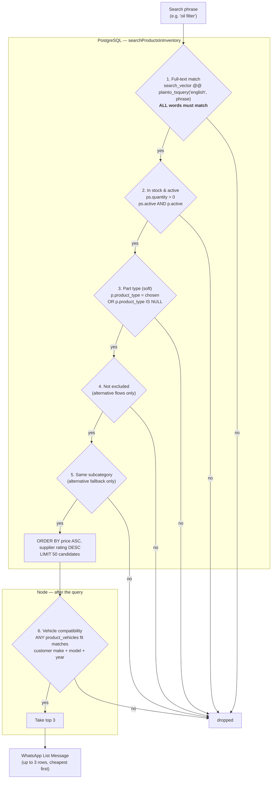
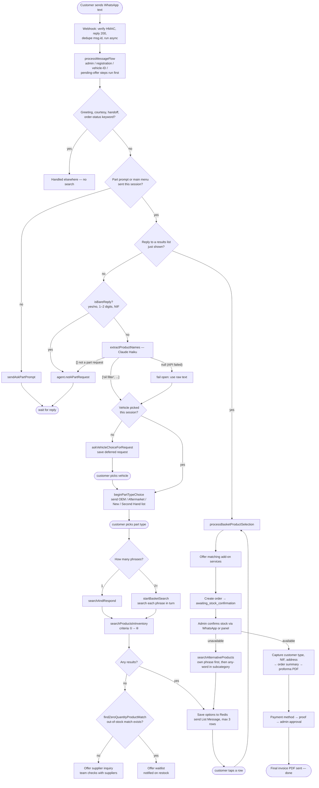
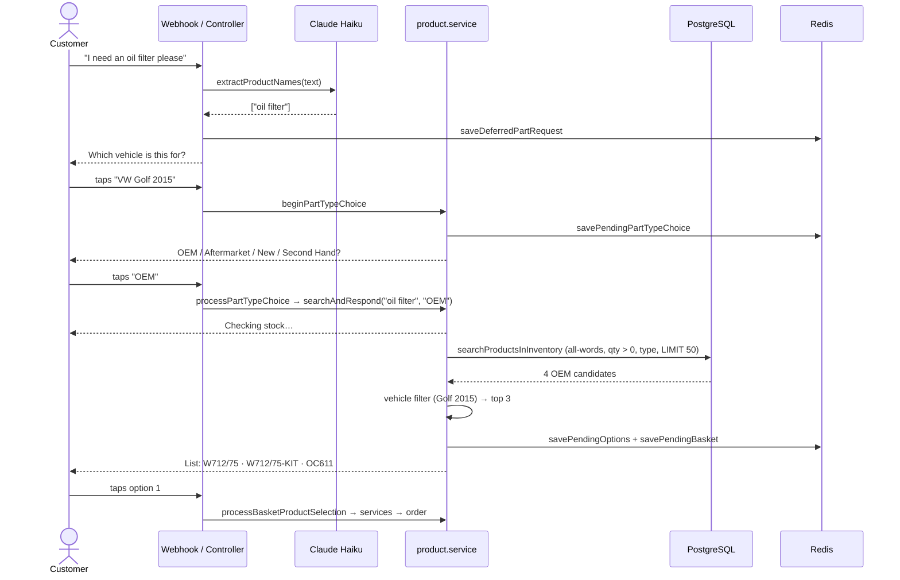

# Product Search — Criteria & Flow

How a customer's WhatsApp message becomes a list of parts. Covers **what decides a match**, a **worked example** against `db/seed.sql`, and the **end-to-end flow**.

Source of truth:

| Concern | File |
|---|---|
| Routing into search (pipeline steps 14, 16, 21, 26) | `src/controllers/whatsapp.controller.ts` → `processMessageFlow` |
| Part-phrase extraction (Claude Haiku) | `src/services/ai.service.ts` → `extractProductNames` |
| Part-type prompt, search, results list, no-match fallbacks | `src/services/product.service.ts` → `beginPartTypeChoice`, `processPartTypeChoice`, `searchAndRespond`, `startBasketSearch` |
| SQL query + vehicle compatibility filter | `src/models/product.model.ts` → `searchProductsInInventory`, `findZeroQuantityProductMatch` |
| `search_vector` definition | `db/schema.sql` → `products` table |

---

## 1. Search criteria at a glance

A product offer is returned only if it passes **every** filter below, in this order.



### 1.1 What is searched — `products.search_vector`

A generated `tsvector` (English config, accents stripped) built from these columns concatenated:

| Column | Example (`W712/75`) |
|---|---|
| `name` | Mann Oil Filter W712/75 |
| `brand` | Mann |
| `reference` | W712/75 |
| `oem_reference` | — |
| `synonyms` | oil filter lubricant filter |
| `category_keywords` | oil filter engine |

So a customer can hit a product by its name, brand, supplier reference, OEM reference, or any synonym/keyword the catalog lists.

### 1.2 The six criteria in detail

| # | Criterion | Rule | Why |
|---|---|---|---|
| 1 | **Text match** | `AND_TSQUERY` — every word of the phrase must appear in `search_vector`. English stemming (`filters` = `filter`). | "engine oil" must not surface a timing belt tagged "engine". |
| 2 | **Stock** | `product_suppliers.quantity > 0`, offer and product both `active = true`. | Never offer what can't be sold. |
| 3 | **Part type** | Customer's pick (OEM / Aftermarket / New / Second Hand) must equal `product_type` — **but `NULL` always passes**. | Soft filter so un-backfilled catalog rows never make search silently empty. |
| 4 | **Exclusions** | `ps.id NOT IN excludeProductIds` | Only used when finding an alternative for a rejected item. |
| 5 | **Subcategory** | `p.subcategory = X` | Only in the alternative fallback, which switches to **any-word** matching (`OR_TSQUERY`). |
| 6 | **Vehicle fit** | Product passes if it has **no** fits, or **any** `product_vehicles` row matches on make, model and year (rules below). | A part is shown only if it fits the car being searched for. |

**Vehicle fit rules** (`vehicleFieldMatches` / `vehicleYearMatches`):

- Make / model: case-insensitive; the product value may hold `/`-separated options; equal **or** substring either way passes (`Golf` ↔ `Golf VII`).
- `Various`, `Universal`, `Aftermarket` as make/model → fits everything.
- Missing value on either side → passes.
- Year must be within `year_start..year_end` (either bound may be null); unparseable customer year → passes.

**Ranking:** `price ASC`, then `suppliers.rating DESC`. The SQL fetches 50 candidates *before* the vehicle filter, then the first 3 compatible ones are shown.

**Which vehicle?** `resolveSearchVehicle` — the customer's only vehicle, or the one picked in "which vehicle is this for?" for customers with 2+.

---

## 2. Worked example (seed data)

**Customer:** has a confirmed *Volkswagen Golf 2015*.
**Message:** `I need an oil filter please`

### Step by step

| Step | What happens | Result |
|---|---|---|
| 1 | `isBareReply`? | No — not yes/no, a number, or a NIF. |
| 2 | `extractProductNames` (Claude) | `["oil filter"]` → one phrase → single search (2+ would be a basket). |
| 3 | Vehicle not yet picked this session → "which vehicle?" | Customer taps *VW Golf 2015*. |
| 4 | Part-type list sent | Customer taps **OEM**. |
| 5 | `searchAndRespond(phone, "oil filter", name, "OEM")` | Runs the query below. |

### Criteria applied to the catalog

| Product | Ref | Type | Price (Kz) | Qty | Fits | ① Text | ② Stock | ③ OEM | ⑥ Golf | Outcome |
|---|---|---|---|---|---|---|---|---|---|---|
| Mann Oil Filter | W712/75 | OEM | 2 500 | 8 | Various | ✅ | ✅ | ✅ | ✅ | **#1** |
| Mann Oil Filter Kit | W712/75-KIT | OEM | 2 500 | 6 | Various | ✅ | ✅ | ✅ | ✅ | **#2** |
| Mahle Oil Filter | OC611 | OEM | 3 800 | 5 | Various | ✅ | ✅ | ✅ | ✅ | **#3** |
| Original VW Oil Filter | 06J115403Q | OEM | 5 200 | 2 | Volkswagen | ✅ | ✅ | ✅ | ✅ | cut — 4th, top 3 only |
| Bosch Oil Filter | P7153 | Aftermarket | 3 100 | 12 | Various | ✅ | ✅ | ❌ | — | dropped by part type |
| Golf Front Brake Pads | TEX2369201 | Aftermarket | 7 200 | 10 | Volkswagen | ❌ | — | — | — | dropped by text |

What the customer gets:

```
Found 3 options for "oil filter" for your Volkswagen Golf 2015:

 1. Mann Oil Filter W712/75   Ref: W712/75 • Brand: Mann • 2 500 Kz • Delivery: Today • Luanda Auto Parts
 2. Mann Oil Filter W712/75…  Ref: W712/75-KIT • Brand: Mann • 2 500 Kz • …
 3. Mahle Oil Filter OC611    Ref: OC611 • Brand: Mahle • 3 800 Kz • …
```

The options are saved to Redis (`options:<phone>`). A tap on a row (or typing `1`–`3`) goes to `processBasketProductSelection` → add-on services → order.

### Counter-example: the vehicle filter blocks it

Same message flow, but the customer drives a **Toyota Corolla 2012**, asks for `front brake pads`, and picks **Aftermarket**.

- `TEX2369201` passes text, stock and type, but its only fit is `Volkswagen` → **dropped at ⑥**.
- Nothing left → `findZeroQuantityProductMatch` looks for an out-of-stock (`quantity = 0`) match → none.
- Customer gets the **supplier-inquiry offer** ("should our team check with suppliers?") instead of a dead end.

---

## 3. End-to-end flow



### Message sequence for the worked example



---

## 4. Gotchas worth knowing

- **Portuguese search works through the catalog's `synonyms`, not translation.** `search_vector` and the tsquery use the `'english'` config, and `extractProductNames` does **not** translate (`"filtro de óleo"` stays Portuguese). It matches because the imported catalog stores both languages in `synonyms` (e.g. `filtro de óleo (elemento), oil filter element`) — verified on a 642-product catalog: `filtro de óleo` → 28 matches, `pastilhas de travão` → 6. Keep this in mind for imports: `synonyms` is required by the CSV import, and a row without Portuguese terms in it will be invisible to Portuguese searches. Note `db/seed.sql`'s sample products only have English synonyms, so Portuguese searches won't hit them in a seed-only dev DB.
- **All-words matching is strict.** Extra words in the phrase cut results — this is why the extracted phrase is searched, not the raw message ("I need … please" would fail every query).
- **The 50-candidate cap is applied before the vehicle filter.** On a very large catalog, a common phrase could fill all 50 slots with cheap parts that don't fit the car, leaving fewer than 3 (or zero) compatible results even though fitting parts exist.
- **`product_type IS NULL` and empty fits are wildcards.** Rows imported without these fields show up for every part type and every vehicle.
- **The waitlist is vehicle-aware too.** `findZeroQuantityProductMatch` applies the same fit rule (criterion ⑥) to out-of-stock matches, so a customer is only offered the waitlist for a part that fits their car; if none fits, they get the supplier-inquiry offer instead.
